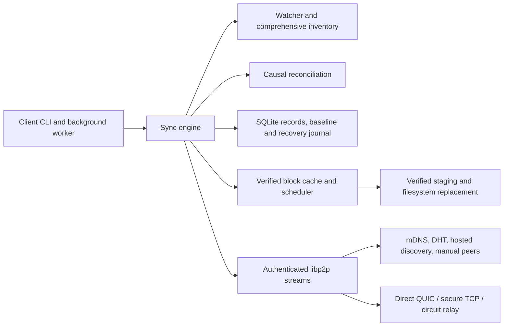

# Architecture and state upgrades

HappySync is a local-first replicated folder. Each root has its own invitation, persistent libp2p identity, SQLite database, block cache, and exclusive process lock. A peer holds complete regular files after convergence; metadata exchange and file transfer continue independently when peers disappear.

## Components

The foreground command and detached worker run the same engine. The parent of a background worker waits for READY after state initialization and the control endpoint have succeeded. Linux and macOS use a private local socket and file lock. An unreachable control endpoint reports a stopped instance, rather than displaying old connectivity information. HappySync does not install an automatic boot service.

The index maps safe physical paths to normalized portable paths, reads scoped ignore rules, and creates BLAKE3 manifests. Notifications prompt scans; periodic comprehensive scans recompute hashes even when size and timestamps match. Failed inventory never becomes an authoritative deletion snapshot. Ignored, unsupported, and rejected paths remain visible in warnings where applicable.

The store keeps immutable operations, monotonic local counters, applied baselines, transfer checkpoints, and filesystem-application journals. The reconciler computes a deterministic projection from the maximal causal frontier, preserving differing concurrent contents. Received metadata only becomes a baseline after the filesystem has safely applied it. See [reconciliation](reconciliation.md) for import, tombstone, conflict-copy, and directory rules.

Baseline causality is joined per completed original path once all its projected branches are settled. Pending downloads on unrelated paths cannot prevent a safely completed path from observing identical concurrent versions. Received-but-unapplied branches remain outside that path's baseline. Initial observations reserve counters and persist records/baselines in transactional batches; cached record-set digests and bounded byte-sized metadata pages avoid repeated idle full snapshots.

The scheduler queries availability, downloads distinct blocks concurrently from available authenticated peers, retries other sources on failure, and checkpoints only verified blocks. Cached partial blocks can immediately be served to another peer. Assembly checks whole-file length and BLAKE3 before publication. Application rechecks the destination against its baseline and journals changes, protecting edits made during downloads. Restart recovery verifies installed bytes before completing bookkeeping. Completed staging blocks are released after installation; the engine serves those contents from its local file index. Active manifests lease their blocks so another completed transfer cannot remove shared blocks still in use.

A second destination check after journal persistence protects edits made during that IO wait. File-to-directory changes preserve the original in a journaled private backup across filesystem operations; recovery restores it or creates a conflict preservation copy if the destination changed. Startup rejects unsafe staging ancestors and removes only regular orphan block-write temporaries. After journal recovery it reclaims unreferenced `install-*` assembly stages, preserving hash-named partial blocks and private backups. Failed journal publication removes its unpublished assembly. Optional int64 Unix-nanosecond record mtimes are applied best-effort to regular files and never decide causality.

## Persistent layout

| Relative path | Purpose |
| --- | --- |
| `.HappySync/config.json` | Versioned invitation and local network/ignore preferences |
| `.HappySync/identity.key` | Persistent private libp2p identity |
| `.HappySync/state.db` | SQLite records, counters, baselines, journals, and checkpoints |
| `.HappySync/state.db-wal`, `state.db-shm` | SQLite transaction files while running |
| `.HappySync/tmp/` | Verified block cache and assembled staging files |
| `.HappySync/runtime/` | Local lock/control runtime state |
| `.HappySync/logs/` | Private worker diagnostics |

All state is reserved from synchronization. Private state on Linux and macOS is restricted to the owner. The config and identity contain secrets and must never be committed or included in public diagnostics. A folder's state is part of its recovery history: deleting it discards clocks, tombstones, and identity. Do not reset it as a troubleshooting shortcut.

Application events in `operations.log` are redacted and rotated during use. Native library stderr retains an inherited append descriptor to `worker.log`; a guard truncates the same file above 10 MiB at startup and at one-second intervals. This is a periodic retention limit with possible growth between checks, not a strict byte-write quota. It discards older native history while avoiding descriptor replacement races.

## Resource controls

The default transfer concurrency is eight workers, configurable with `--workers` from 1 to 64. Each download handles fixed 4 MiB blocks; memory depends on active workers and metadata, rather than full file length. `--staging-limit` bounds cached block bytes (default 8 GiB). Assembly additionally needs temporary space roughly equal to the file length, and safe replacement may retain the current file while staging. Choose a cache limit that can accommodate the largest transfer, and provision disk space for both cache and assembly. Exhaustion produces pending work/errors; it must not expose a truncated destination.

`--scan-interval` sets comprehensive rehash frequency (default ten minutes; minimum one second). Cheap watcher-triggered inventory and comprehensive hashing have different costs. Worker, staging, and scan settings are runtime flags and must be supplied on each restart. Network streams, metadata pages, candidates, discovery registrations, and relay capacity have separate caps documented in [protocol](protocol.md) and [server guide](server.md).

Persistent `--upload-rate` and `--download-rate` options cap aggregate application-stream bytes per second across authenticated peers; zero leaves the client direction uncapped. Separate shared paced budgets govern each direction, and cancellation interrupts waits. They include metadata and frame encoding overhead after authentication, so payload throughput differs from the configured byte rate. Server relay pacing applies independently to opaque encrypted traffic.

Version 1 retains tombstones and immutable operation history indefinitely. Their disk and metadata costs grow with changes; no age-based compaction is safe under the v1 offline-peer model. The 100,000-file inventory target is measured separately from long-lived histories and whole-engine memory; see [validation](validation.md).

## Upgrade policy

Invitation/config/wire/record format is version 1. SQLite schema is version 2. These versions are independent. New databases migrate transactionally through schema 1 to schema 2. The 1-to-2 migration adds local metadata without rewriting existing causal records, counters, baselines, journals, or transfer checkpoints. Tests reopen migrated databases and verify preserved values. Startup performs SQLite `quick_check`, validates required tables and counters, and rejects a schema newer than supported instead of guessing its meaning.

Stop the instance before upgrading. Back up user files and the entire `.HappySync/` directory together after stopping, including transaction files if present. Preserve the invitation and identity. Run the new binary against a disposable restored copy first when evaluating a development upgrade. A rollback after migration requires restoring that backup; copying an old executable alone does not reverse state changes. Never open one state directory with multiple writers.

There is no promised mixed-development-version compatibility before a stable release. Unknown invitation/config versions, unsupported protocols, invalid records, and unknown framed-message fields fail safely. A change to invitation encoding, discovery derivation, operation identity, or reconciliation semantics requires explicit versioning and compatibility tests. Do not silently assign old data a new meaning.

To relocate a root, stop first and move user files and `.HappySync/` together after recovery has completed at the original location. Invitation, identity, and relative record history survive a normal stopped move; outstanding stage/backup journal paths are absolute private paths, so moving an interrupted root before recovery is unsupported. Copying `.HappySync/` onto another device is not a join workflow: use the invitation and independently initialized state. A configured manual candidate that presents the local Peer ID exposes a duplicate-identity error; automatic discovery cannot reliably distinguish a cloned device from this root's own identity or roaming addresses.

## Deliberate v1 choices

Wire messages use strongly typed, bounded JSON with a big-endian length prefix. This keeps decoding inspectable and avoids a separate schema-generation toolchain; it is not a protobuf implementation. An authenticated cached digest of the immutable record set skips redundant idle metadata exchange. When sets differ, records are paged by immutable IDs, and callers repeat synchronization rounds to obtain operations added while paging. There is no filesystem snapshot primitive or transaction spanning remote peers.

Transport encryption uses mature libp2p QUIC/TLS and secure TCP negotiation. Group membership is an additional stream handshake using independent HKDF keys and fresh MAC challenges, not a new encryption transport. The current libp2p API does not expose a common authenticated transport exporter for this construction; proofs bind both transport-authenticated Peer IDs and the versioned stream protocol. See [protocol](protocol.md) for exact bytes and limitations.

Public DHT provider policies, consumer NATs, DCUtR success, and VPS deployment remain external acceptance work explicitly deferred by the user. Automated loopback/multicast/circuit tests validate local behavior only. Native Linux and macOS CI is provided; cross-compilation for another architecture is separate evidence, not a native test result.
